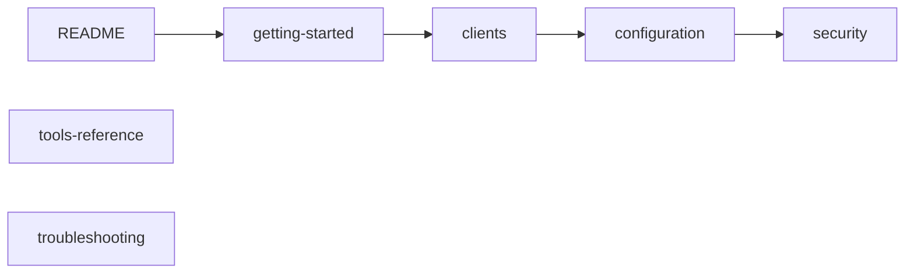

# Documentation

Documentation for the `hetzner-model-context-protocol` MCP server. For a short overview and the quick start, see the [README](../README.md).

## Using the server

| Document | Content |
|---|---|
| [getting-started.md](getting-started.md) | Project and API token, first run, MCP Inspector |
| [clients.md](clients.md) | Setup in Claude Desktop, Claude Code, VS Code, Cursor and other stdio clients, token handling |
| [configuration.md](configuration.md) | All environment variables, toolsets, safety controls, cost controls, label scope |
| [tools-reference.md](tools-reference.md) | Every tool, prompt and resource with parameters, annotations and output. Generated by `npm run docs:tools`, do not edit by hand |
| [security.md](security.md) | Trust boundaries, guard chain, token permissions, cost controls and their limits, prompt injection, audit log, operations checklist, known limitations |
| [troubleshooting.md](troubleshooting.md) | Symptoms, causes and fixes, with the exact error messages |

To run the server, read `getting-started`, `clients` and `configuration`, then go through the checklist in `security` before you connect a project that holds anything you cannot afford to lose. Look things up in `tools-reference` and `troubleshooting` as needed.

## Contributing

| Document | Content |
|---|---|
| [architecture.md](architecture.md) | Modules, request lifecycle, design decisions, adding a tool, test levels |
| [CONTRIBUTING.md](../CONTRIBUTING.md) | Setup, scripts, commit conventions |

## Project files

[SECURITY.md](../SECURITY.md) (supported versions, how to report a vulnerability privately), [CODE_OF_CONDUCT.md](../CODE_OF_CONDUCT.md), [LICENSE](../LICENSE).
