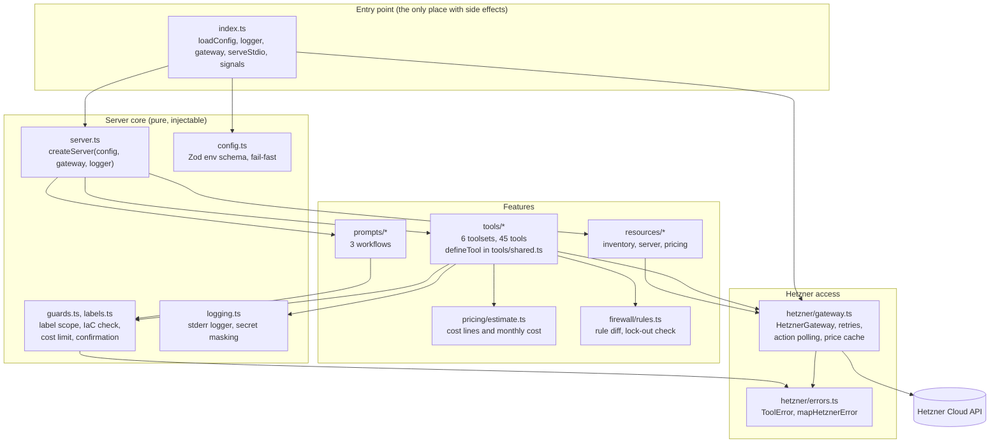
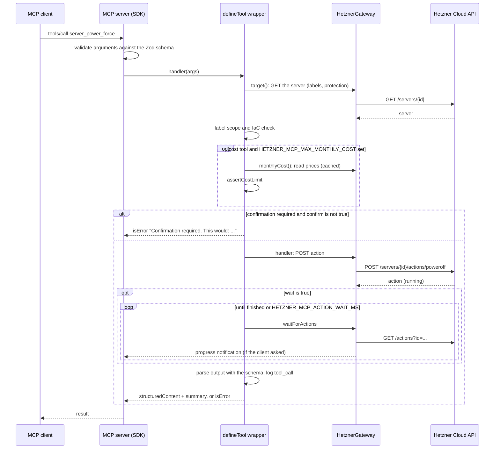

# Architecture

This page explains how the server is built, how a request flows through it, why some decisions were made and how to extend it. The security view is in [security](security.md).

## Modules



| Module | Responsibility |
|---|---|
| `src/index.ts` | Shebang entry point. Loads the config, creates logger and gateway, starts `serveStdio`, handles `SIGINT` and `SIGTERM`. A `ConfigError` prints a readable message to stderr and exits with code 1. |
| `src/server.ts` | `createServer({ config, gateway, logger })` builds the `McpServer` with the server instructions and registers tools, prompts and resources. No I/O, so tests can start it in memory. |
| `src/config.ts` | Parses the environment with Zod. No default for the token. Resolves toolsets and flags, validates label terms, collects startup warnings. |
| `src/guards.ts`, `src/labels.ts` | Pure policy functions: path segment check, `assertMutable` (label scope and IaC), `withScopeLabels`, `keepScopeLabels`, `assertSelectorInScope`, `requireConfirmation`, `assertCostLimit`; label parsing and matching. |
| `src/logging.ts` | Level-based logger to stderr. Masks the configured token and redacts sensitive field names. |
| `src/tools/shared.ts` | `defineTool`, the shared input fields (IDs, names, labels, pagination), `pageOf`, `quoteName`, the wait and progress logic. |
| `src/tools/*.ts` | One file per domain (`servers`, `catalog`, `actions`, `ssh-keys`, `firewalls`, `storage`). `tools/index.ts` holds the `TOOLSETS` registry and `selectTools`. |
| `src/pricing/estimate.ts` | Cost lines for previews and the monthly amount for the cost limit, from the same amount functions. |
| `src/firewall/rules.ts` | Rule normalisation, the diff and the lock-out check of `firewall_set_rules`. |
| `src/prompts/*`, `src/resources/*` | Workflow prompts and read-only resources, built on the same gateway and guards. |
| `src/hetzner/gateway.ts` | The only way to reach Hetzner: requests, retries, rate-limit tracking, action polling, cached price list. |
| `src/hetzner/errors.ts` | `ToolError` (message safe to show) and `mapHetznerError` (HTTP status and network errors to clean messages). |

Dependencies point inward: features depend on the `HetznerGateway` interface, never on the HTTP client, which is why tests can replace Hetzner with a fake.

## Request lifecycle



Key properties:

- **The guard chain lives in `defineTool`.** Order: schema, target, label scope and IaC, cost limit, confirmation, handler, wait, output parsing, error mapping and audit line. A new tool cannot forget a step. The cost limit runs independent of `confirm`, so `confirm: true` does not bypass it.
- **One GET per changed resource.** A write tool's `target()` loads each existing resource it changes. Guards, preview and handler share that state.
- **Errors are values.** Everything that goes wrong in a handler becomes a `ToolError` and then an `isError: true` result with a clean message. Protocol errors are left to invalid parameters.
- **Output is an allowlist.** Projections name every field they copy, and `outputSchema.parse` strips anything else. A tool whose output schema declares `root_password`, `password`, `wss_url` or `user_data` fails at definition time.
- **Tool registration does not call the gateway.** The tools reference generator hands the server a gateway that throws on every call.

### The gateway

`HttpHetznerGateway` is the only code that talks to Hetzner. It sends `Authorization: Bearer <token>`, `Accept` and a `User-Agent` with the package version, uses a per-attempt timeout plus the client's cancellation signal, and keeps the rate-limit headers of the last response.

**Retries are limited to what cannot cause a duplicate effect.** A repeated `POST /servers` would cost money, so creating requests (`POST`) are never repeated. At most 2 retries (3 attempts), with a wait of up to 5 seconds; a longer wait is not taken and the error is returned.

| Trigger | GET | PUT | DELETE | POST |
|---|---|---|---|---|
| 429 rate limit, 503 unavailable | retry | retry | retry | never |
| 502, 504 | retry | never | never | never |
| 409 conflict | retry | retry | never | never |
| network error | retry | never | never | never |
| own timeout, cancellation by the client | never | never | never | never |

**Waiting for actions.** `waitForActions` polls `GET /actions?id=...` with growing intervals (1 s up to 5 s, always 5 s when the remaining quota is low) until all actions finish or `HETZNER_MCP_ACTION_WAIT_MS` has passed. It reports progress as the average of the actions' progress, increasing only.

**Prices.** `getPricing` reads `GET /pricing` once and caches it in memory for one hour. Both the cost lines in previews and the cost limit use it. Without `HETZNER_MCP_MAX_MONTHLY_COST` the cost limit does not read prices.

## Design decisions

### `confirm` parameter instead of elicitation

Destructive and cost-incurring tools take a `confirm` flag; without it they return a preview and change nothing. MCP elicitation (the server asks the user through the client) was not used: many clients do not implement it, a plain parameter works with every client and transport, can be tested without a client simulator and gives the model a clear recovery path (ask the user, call again). The honest limitation: `confirm` is a flag set by the model, not proof that a human clicked. See [known limitations](security.md#known-limitations).

### Cost-incurring write tools are not destructive

Tools like `server_create` or `volume_create` do not lose data, so they are annotated `destructiveHint: false`. A `costs` marker still gives them the `confirm` parameter and a mandatory preview with the estimated cost, and puts them under `HETZNER_MCP_ALLOW_COSTS` and `HETZNER_MCP_MAX_MONTHLY_COST`. The `costs` marker on a destructive tool (for example `server_change_type`) only adds those two controls.

### Static toolsets

Which tools exist is decided once at startup from `HETZNER_MCP_TOOLSETS`, `HETZNER_MCP_READ_ONLY` and `HETZNER_MCP_ALLOW_COSTS`. There is no runtime toggling and no `tools/list_changed` handling:

- A tool that is not registered cannot be called, which is a stronger guarantee than a check inside the handler.
- Fewer tools in the context window improve tool selection by the model. The default exposes 21 of 45 tools.
- Static lists are predictable for operators and for the generated [tools reference](tools-reference.md).

### Pagination as Hetzner does it

List tools take `page` (from 1) and `per_page` (default 25, at most 50) and return `{ items, page, per_page, next_page, total_entries }`, taken from the pagination block of the API response.

### Other decisions

- **One project per server.** A Hetzner API token belongs to one project, so the server works on one project and tools take no project argument. The name from `HETZNER_MCP_PROJECT_NAME` only labels the log lines.
- **Structured output.** Every tool has an `outputSchema`. The model gets `structuredContent`; `content` holds only a neutral summary, never free text from Hetzner.
- **Protection is not a guard.** Hetzner refuses protected operations with `423 protected`. The preview shows an active protection first instead of the server re-implementing the decision.
- **Small machinery.** Each preview feature is a single function (diff, lock-out check, cost line). There is no cost counter, no pre-flight simulation and no throttling of normal requests by the rate limit.
- **Streamable HTTP is out of scope.** The server speaks stdio.

## Adding a tool

1. **Pick the domain file** in `src/tools/` (or create one and add it to `TOOLSETS` in `src/tools/index.ts`). The tool name is `<domain>_<verb>` in snake case.
2. **Define the tool with `defineTool`:**

   ```ts
   const sshKeyGet = defineTool({
     name: "ssh_key_get",
     title: "Get an SSH key",
     description:
       "Returns one SSH key by ID, including its public key text and fingerprint. Say what it does and what it does not return.",
     kind: "read", // "read" | "write" | "destructive"
     input: z.object({ id: idField("SSH key") }), // every field needs .describe(...)
     output: sshKeyOutput,
     handler: async (args, ctx) => {
       const raw = await ctx.gateway.request<{ ssh_key: HetznerSshKey }>(
         "GET",
         path`/ssh_keys/${args.id}`,
         { signal: ctx.signal },
       );
       return { data: { ssh_key: toSshKeyOut(raw.ssh_key) }, summary: `Returned SSH key ${args.id}.` };
     },
   });
   ```

   Rules enforced by `defineTool` and the tests:
   - Write and destructive tools need `target()` (loads the existing resources they change) or `creates: true`. Destructive tools and tools with `costs: true` must provide `preview()`; `costs` tools also need `monthlyCost()`.
   - The input must not declare `confirm`, `wait` or `project` (added automatically), and the output must not declare `warnings` or `actions` or any sensitive key.
   - Tools that start Hetzner actions set `actions: true` and return the actions from the handler.
   - Every input field needs a description; every tool needs `title`, `description` and `outputSchema`.
   - Build paths with the `path` template, which validates and encodes every segment.
   - Projections name each returned field. Keep text from Hetzner (names, labels, descriptions) out of `summary`.
3. **Register it** in the exported array of the file (for example `sshKeyTools`).
4. **Write unit tests** in `tests/unit/`. The harness starts the real `createServer` with `FakeHetzner`, an in-process route table that answers with fixtures, and connects an SDK client over an in-memory transport:

   ```ts
   const t = await startHarness();
   t.fake.on("GET", "/ssh_keys/{id}", ok(fixture("get_ssh_key")));
   const res = await t.call("ssh_key_get", { id: 42 });
   ```

   Also extend `tests/unit/tools-list.test.ts` and `tests/unit/tools-registry.test.ts` when the tool list changes.
5. **Regenerate the reference:** `npm run docs:tools`. `npm run docs:check` exits with code 1 when `docs/tools-reference.md` is stale; CI runs it as part of linting.
6. **Check the quality gates:** `npm run lint`, `npm run typecheck`, `npm test`. Use a `feat:` commit title (see [CONTRIBUTING.md](../CONTRIBUTING.md)).

## Test strategy in short

There are four test levels. **Unit** tests (`npm test`, every commit, in CI) run every tool, prompt and resource through a real MCP client over an in-memory transport against `FakeHetzner` and fixtures taken from the Hetzner OpenAPI specification; they need no network and cost nothing. **Contract** tests start the built `dist/index.js` as a child process, talk to it with the SDK client over stdio and let it call a small local stub HTTP server on `127.0.0.1` that answers with the same fixtures; they run on every build and also cost nothing. **Live tests without costs** run by hand against a dedicated test project before every release: reading, SSH keys, firewalls and labels, with `HETZNER_MCP_ALLOW_COSTS=false`. **Live tests with costs** run by hand before minor and major releases and create real servers, volumes and snapshots with a small budget, a cost limit set and clean-up by label afterwards. No token is used in CI.
