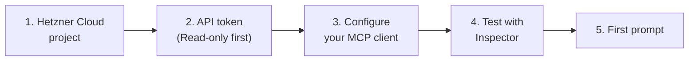

# Getting started

This guide takes you from nothing to a working Hetzner Cloud MCP server, step by step: a project and an API token, the client configuration, a test with the MCP Inspector, and your first prompt.



## Prerequisites

- **Node.js 22 or newer** (`node --version`).
- A **Hetzner Cloud account** with a project. The server works on exactly one project, the one the API token belongs to.
- An **MCP client** ([clients](clients.md)).

## 1. Choose the project

Use a project that contains what the assistant may see and change, and nothing else. A separate project for experiments is the safest start. A token belongs to exactly one project, so the project decides how far a mistake can reach.

## 2. Create an API token

In the Hetzner Cloud Console:

1. Open the project.
2. Go to *Security > API Tokens* and create a token.
3. Choose the permission. **Start with a Read-only token.** It is enough for every read tool and for the prompts `audit_project_security` and `review_costs`. Use a Read & Write token only when you want the assistant to change things.
4. Copy the token and keep it out of version control.

The exact labels in the Console may differ from this description; Hetzner's documentation is authoritative.

> [!NOTE]
> The cost controls of this server (`HETZNER_MCP_ALLOW_COSTS`, `HETZNER_MCP_MAX_MONTHLY_COST`) do not replace a Read-only token. See [security](security.md#cost-controls-and-their-limits).

## 3. Configure your MCP client

Example for Claude Code with a read-only setup:

```bash
export HETZNER_TOKEN='<api-token>'

claude mcp add --transport stdio \
  --env HETZNER_TOKEN='${HETZNER_TOKEN}' \
  --env HETZNER_MCP_READ_ONLY=true \
  hetzner -- npx -y hetzner-model-context-protocol
```

Other clients and the handling of the token: [clients](clients.md). All variables: [configuration](configuration.md).

By default the server enables the toolsets `core`, `info`, `actions` and `ssh_keys` (21 tools). Add `firewalls` and `storage` with `HETZNER_MCP_TOOLSETS=all` when you need them.

## 4. Test with the MCP Inspector

The [MCP Inspector](https://github.com/modelcontextprotocol/inspector) starts the server and lets you call tools by hand:

```bash
HETZNER_TOKEN='<api-token>' HETZNER_MCP_READ_ONLY=true \
  npx @modelcontextprotocol/inspector npx -y hetzner-model-context-protocol
```

In the Inspector, open the *Tools* tab, list the tools and run `server_list` (arguments are optional) or `catalog_locations`. A successful result has a short text summary and a `structuredContent` with the data. Check the *Prompts* and *Resources* tabs as well: `hetzner://inventory` returns the resource counts of the project.

If the server cannot start, the reason is printed on stderr, see [troubleshooting](troubleshooting.md#server-does-not-start).

## 5. First prompt

> _List the servers in my Hetzner project and tell me which ones are switched off._

Then try one of the guided prompts, for example `review_costs` or `audit_project_security` (in Claude Code they are slash commands such as `/mcp__hetzner__review_costs`; `audit_project_security` works best with the `firewalls` toolset enabled).

## 6. Allow changes, step by step

When you want the assistant to change something:

1. Switch to a Read & Write token and remove `HETZNER_MCP_READ_ONLY`.
2. Think about limits first: `HETZNER_MCP_LABEL_SCOPE` to confine changes to labelled resources, `HETZNER_MCP_ALLOW_COSTS=false` to remove the tools that order or enlarge things, or `HETZNER_MCP_MAX_MONTHLY_COST=5.00` to reject single calls above a monthly amount.
3. Keep confirmation on. A destructive or cost-incurring tool then answers its first call with a preview. The assistant must show it to you and call again with `confirm: true` after you agreed.
4. Try it on something harmless: create a labelled SSH key with `ssh_key_create`, rename it with `ssh_key_update`, delete it with `ssh_key_delete` and look at the preview.

Servers and volumes cost money from the moment they are created. Check the preview before you approve.
