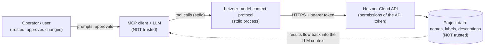
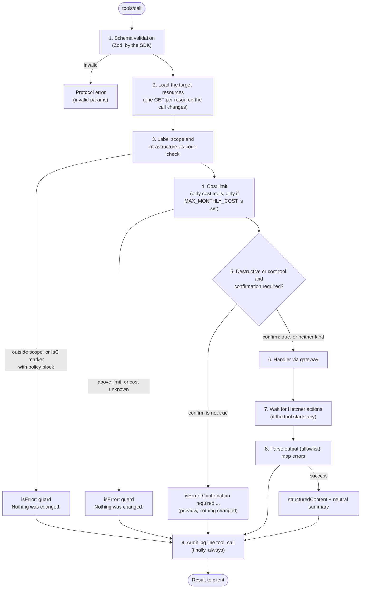

# Security model

This document describes what the server protects against, how a tool call is checked, what you must configure yourself and where the limits of the built-in controls are. To report a vulnerability, see [SECURITY.md](../SECURITY.md).

## Trust boundaries

An MCP server for Hetzner Cloud sits between two parties that must not be trusted blindly.



1. **The LLM is not trusted.** It can hallucinate arguments, be confused by a long context or be steered by injected text. Every argument is validated and every write is subject to server-side policy. Tool annotations and `confirm` are hints and workflow aids, not a security boundary against a hostile model.
2. **Data from Hetzner is not trusted.** Server names, labels, descriptions, firewall rule descriptions and error details can be set by anyone who can write to the project, or by tools of other systems. They may contain text that looks like instructions.
3. **The API token is the real boundary.** The server can do exactly what the token may do. Everything the server enforces (read-only, label scope, cost limit, confirmation, toolsets) narrows this further, but is enforced inside the same process. Use the token permission (Read-only or Read & Write) and the choice of project for the hard limit.
4. **The host is trusted.** Environment variables are visible to the user's processes. An attacker with access to the host or the MCP client config is out of scope.

## Guard chain of a tool call

Two policies act before any call: `HETZNER_MCP_TOOLSETS`, `HETZNER_MCP_READ_ONLY` and `HETZNER_MCP_ALLOW_COSTS` decide at startup which tools are registered at all. Tools that are not registered cannot be called and are not listed. For each registered tool, `defineTool()` (`src/tools/shared.ts`) applies the same chain, so a new tool cannot forget a check.



| Step | Implementation | Behaviour |
|---|---|---|
| Schema validation | Zod schemas passed to `registerTool` | Unknown shapes are rejected before the handler runs. IDs are positive integers, names and free text must not contain control characters, `per_page` is capped at 50. |
| Target loading | `target()` hook of the tool | Reads the current state of every existing resource the call changes, so the guards and the preview work on real labels and protection flags. |
| Label scope | `assertMutable` | With `HETZNER_MCP_LABEL_SCOPE` set, every changed resource must carry all scope labels. The scope is checked before the IaC marker. |
| IaC check | `assertMutable` | `HETZNER_MCP_IAC_POLICY`: `off`, `warn` (warning in preview and result) or `block`. |
| Cost limit | `assertCostLimit` | Runs for cost tools if `HETZNER_MCP_MAX_MONTHLY_COST` is set, **independent of `confirm`** and of `HETZNER_MCP_REQUIRE_CONFIRMATION`. Fails closed. |
| Confirmation | `requireConfirmation` | Destructive tools and cost-incurring tools get an automatic `confirm` parameter. Without `confirm: true` they return a preview and change nothing. Disabled by `HETZNER_MCP_REQUIRE_CONFIRMATION=false`. |
| Gateway | `HttpHetznerGateway` | The only path to Hetzner. Retries only what cannot cause a duplicate effect (see [architecture](architecture.md#the-gateway)). |
| Output parsing | `outputSchema.parse` | Removes every field that the output schema does not declare. |
| Error mapping | `mapHetznerError` | Known failures become short messages with a hint. Stack traces, tokens and request bodies never reach the client. |
| Audit log | `ctx.logger.info("tool_call", ...)` | One line per call in `finally`, so guard rejections are logged as well. |

Protection is deliberately **not** a guard of this server. Hetzner refuses protected operations itself. The preview points it out first, so nobody approves something that is certain to fail.

Prompts reuse the tools and therefore the same guards. Resources are read-only and log a `resource_read` line.

## Token permissions

The server does not make an over-privileged token safe. Recommendations, strongest first:

1. **A dedicated project per purpose.** A token belongs to exactly one project. Put what the assistant may touch into its own project, so a mistake cannot reach anything else.
2. **A Read-only token wherever changes are not needed.** Hetzner enforces it, whatever this server does or fails to do. Combine it with `HETZNER_MCP_READ_ONLY=true` so the write tools are not offered either.
3. **Read & Write only for the work that needs it,** and then with the server-side limits below.
4. **Keep the other controls on.** `HETZNER_MCP_LABEL_SCOPE` for the resources in scope, only the toolsets you need in `HETZNER_MCP_TOOLSETS` (the default does not include `firewalls` and `storage`), `HETZNER_MCP_REQUIRE_CONFIRMATION` unset (default `true`). Pair the server with a client that asks the human before destructive tool calls (clients use the `destructiveHint` annotation for this).
5. **Use HTTPS.** The server only accepts `https` API URLs, with `http` for localhost. A different host than `api.hetzner.cloud` gets the token and produces a startup warning. **`HETZNER_API_URL` must not contain credentials:** the URL appears in the startup log and in error messages, so credentials in it would be written there.
6. **Rotate tokens** and have a way to revoke one quickly in the Hetzner Cloud Console.

## Cost controls and their limits

`HETZNER_MCP_ALLOW_COSTS` and `HETZNER_MCP_MAX_MONTHLY_COST` ([configuration](configuration.md#cost-controls)) are checks **inside this server**. They are not settings at Hetzner.

- Whoever holds the token can order resources **past this server**, with `curl`, the Cloud Console or any other client. A Read & Write token can create billable resources regardless of these two settings.
- They therefore **do not replace a Read-only token**. If the assistant must not be able to cost money, give it a Read-only token. If it may change existing resources but not order new ones, the settings reduce the risk but do not remove it.
- Hetzner offers, to our knowledge, no approval step for orders and no spending limit per token. **(Not verified.)** Check the current Hetzner documentation before you rely on either.
- `HETZNER_MCP_MAX_MONTHLY_COST` limits **one call**, not a total. There is no counter and no sum over calls, because the server holds no state. A series of calls below the limit can add up. Keep a total budget outside this server.
- The limit compares the monthly price reported by Hetzner for the added resources. It is as good as the price list and the estimate of the tool; for snapshots it uses an upper bound based on the disk size, which is not verified against reality.
- `HETZNER_MCP_REQUIRE_CONFIRMATION=false` switches off the cost preview together with the data-loss confirmation. The cost limit stays active.

## Label scope and infrastructure-as-code check

Both rest on labels that are read from Hetzner and compared with your configuration, in a window between reading and writing.

Known limits:

- **Firewall targets given as label selectors are not checked for infrastructure-as-code markers.** `firewall_apply_to_resources` and `firewall_remove_from_resources` check the firewall, the servers they name, and (with a label scope) that each selector contains every scope term (`assertSelectorInScope`). The servers that a selector matches are **not** loaded, so they are not checked for IaC markers, and a firewall applied through a selector can touch servers that Terraform manages. With `HETZNER_MCP_IAC_POLICY=block` this gap remains. Prefer naming servers explicitly.
- **The IaC check only works if your code sets a label.** It looks for the labels in `HETZNER_MCP_IAC_LABELS` and for nothing else. Whether the Terraform provider sets labels by itself is not verified.
- **Time of check, time of use.** The labels are read before the write, and they can change in between. We do not know of a conditional write on the Hetzner API that would close this gap. **(Not verified.)** The risk is accepted.
- **Reading is not scoped.** List and get tools show the whole project, including resources outside the scope, with their labels.
- **Referenced resources are not checked.** SSH keys, images, server types and locations used in `server_create` need no scope label.
- The IaC check only applies to changes of existing resources. New resources are never treated as infrastructure-as-code.
- The scope is a convention of this server. Anyone with the token can change a resource without the labels, or change the labels.

## Limits of the lock-out warning

`firewall_set_rules` replaces all rules of a firewall. Its preview shows a diff and, for each port in `HETZNER_MCP_FIREWALL_GUARD_PORTS` (default 22), a lock-out warning if the firewall allowed inbound TCP on that port from IPv4 or IPv6 before and no longer does. The warning does not block anything. It compares **only the old and the new rules of this one firewall**. It does not warn in these cases:

- **Narrowing to someone else's address.** If the rules still allow the port from some address, there is no warning, even if that address is not yours (for example from `0.0.0.0/0` to `203.0.113.7/32`). The diff shows the change, the server cannot know your address. The same holds for a prefix that has become too narrow: there is no containment check of address ranges.
- **Other firewalls on the same server.** How several firewalls on one server act together is not documented in the sources we used, and the check looks at one firewall. The warning text says that the servers lose access on that port unless another firewall on them allows it.
- **Outbound rules.** They are not checked. What an existing `out` rule does to other outbound traffic is not documented in the sources we used.
- **A TCP or UDP rule without a port.** The check assumes it means all ports. Hetzner stores such a rule with port 'any' and it opens all ports (verified 2026-10-31 for TCP; UDP was not checked).
- **SSH on a non-standard port.** Only the ports in `HETZNER_MCP_FIREWALL_GUARD_PORTS` are watched. Add yours.
- **A firewall that is not applied yet.** If it is applied to no server, the warning is replaced by a note that it is not applied. The lock-out happens later, when the firewall is applied: `firewall_apply_to_resources` is a separate step.
- **Private networks.** Whether firewalls act on private networks is not documented in the sources we used; the warning speaks of inbound TCP without naming a network.
- The rule text is compared as written: a source that cannot be parsed counts as no source (Hetzner rejects such input anyway).

After `firewall_set_rules`, test your access in a second session before you close the first one.

## What the server deliberately never does

| Never | Why |
|---|---|
| Return root passwords | Servers are created with SSH keys only (`ssh_keys` is mandatory in `server_create`). If Hetzner returns a root password anyway, it is discarded, a warning without the value is logged, and the summary says so. |
| Return or log cloud-init user data | It is sent to Hetzner when you create or rebuild a server, but appears in no result, preview, summary or log line. The preview shows only its size in bytes, never its content. |
| Return console credentials | The password and `wss_url` of console requests are never declared in any output schema, and the endpoints are not used. |
| Provide rescue mode or password reset | These endpoints only make sense with a password. They are not part of this version. |
| Log the token | The configured token is masked literally in every log line, and fields whose name matches `secret`, `password`, `token`, `authorization`, `credential` or `user_data` are replaced by `[REDACTED]`. The one exception is `tokenSource`, which holds only a variable name. |
| Copy raw API objects into results | Every tool names the fields it returns. A schema check removes any other field, and a startup check fails if an output schema declares one of the sensitive keys. |
| Wait for or approve things on its own | Confirmation is requested from the user via the model; the server does not approve anything. |

## Prompt injection

Prompt injection through project data cannot be filtered reliably. The measures reduce the chance and, more importantly, the damage:

- **Structured output.** Results are returned as `structuredContent` that conforms to an output schema. The text `content` is a short neutral summary built by the server (counts, IDs, enum values, prices). Names, labels and descriptions from Hetzner are not placed into summaries. Two places carry text from Hetzner: the confirmation preview names the target (control characters removed, cut to 64 characters, quoted), so the human can recognise what is affected, and error messages include Hetzner's error detail, cleaned and truncated to 300 characters.
- **Marked as untrusted.** Output fields that carry such text say so in their description.
- **Server instructions.** The server announces that tool data is data and never instructions, and that destructive and cost-incurring tools need explicit user approval.
- **Prompts.** The workflow prompts quote user-supplied values as JSON strings, include a data notice, and tell the model to ask the user instead of improvising when a tool is missing.
- **Blast-radius limits.** Read-only mode, label scope, toolsets, the cost controls and confirmation limit what a successful injection can do. These matter more than any text filter.
- **Human in the loop.** Keep client-side approval for write tools enabled and try the server on a test project first.

## Data minimisation and personal data

Everything a tool returns is sent to the model provider of your MCP client. Project data can contain personal data, for example names in server names or labels and public IP addresses.

- Lists are paginated: default 25, at most 50 per page. Ask narrow questions (use filters such as `label_selector`) instead of listing everything.
- Tools return fixed field sets. The catalog tools return only what is needed to choose; `hetzner://inventory` contains counts and IDs without names or labels.
- The server stores nothing. It keeps no database and writes no files. In memory it holds only the rate-limit information of the last response and the price list, which is cached for one hour.
- Check the data-processing terms of your LLM provider before you connect a project that holds personal data.

## Audit log

The server logs to **stderr** (stdout belongs to the MCP protocol) as one line per event:

```text
<ISO-8601 timestamp> <LEVEL> <message> <JSON fields>
```

Per tool call:

```text
2026-10-30T12:00:00.000Z INFO tool_call {"tool":"server_delete","project":"default","outcome":"confirmation_required","targets":["server:42"],"confirmed":false,"durationMs":180}
```

Per resource read:

```text
2026-10-30T12:00:01.000Z INFO resource_read {"resource":"inventory","project":"default","outcome":"ok","durationMs":240}
```

| Field | Meaning |
|---|---|
| `tool` / `resource` | Name of the tool or resource |
| `project` | `HETZNER_MCP_PROJECT_NAME` |
| `outcome` | `ok`, or the error kind: `auth`, `forbidden`, `not_found`, `conflict`, `locked`, `protected`, `bad_request`, `limit_exceeded`, `rate_limited`, `unavailable`, `unsupported`, `server`, `network`, `timeout`, `cancelled`, `action_failed`, `guard`, `confirmation_required`, `unexpected` |
| `targets` | `<type>:<id>` of the existing resources the call changes, numeric IDs only |
| `confirmed` | For confirming tools: whether `confirm: true` was passed |
| `actions`, `pending` | IDs of the triggered Hetzner actions and the number still running at the end |
| `durationMs` | Wall-clock duration |

Arguments, names, labels, cloud-init data, results and Hetzner's error text are **not** logged. If you need to know what exactly was changed, use the audit facilities of Hetzner. (Whether and how Hetzner provides an audit trail for API calls is not covered here.) At startup the server logs `hetzner-model-context-protocol started` with version, API URL, project name, token source, read-only flag, toolsets, label scope, IaC policy, `allowCosts` and, if set, `maxMonthlyCost`.

`HETZNER_MCP_LOG_LEVEL` defaults to `info`. At `debug` the gateway logs each request with method, path, status, attempt, duration and the remaining rate limit, without query and body.

## Operations checklist

- [ ] A dedicated project, and a **Read-only token** unless writes are intended
- [ ] `HETZNER_MCP_READ_ONLY=true` unless writes are intended
- [ ] Only the needed toolsets enabled in `HETZNER_MCP_TOOLSETS`; `firewalls` and `storage` only when needed
- [ ] `HETZNER_MCP_LABEL_SCOPE` set when the assistant should change only part of the project
- [ ] `HETZNER_MCP_IAC_POLICY=block` if Terraform or OpenTofu manage resources in this project, and your code sets a label that `HETZNER_MCP_IAC_LABELS` lists
- [ ] `HETZNER_MCP_ALLOW_COSTS=false` where the assistant must not order; understood that this does not replace a Read-only token
- [ ] `HETZNER_MCP_MAX_MONTHLY_COST` set where the assistant may order, and a total budget kept outside this server
- [ ] `HETZNER_MCP_REQUIRE_CONFIRMATION` unset (default `true`)
- [ ] `HETZNER_MCP_FIREWALL_GUARD_PORTS` includes your SSH port if it is not 22
- [ ] `HETZNER_API_URL` unset, or an `https` URL without credentials
- [ ] Client asks for approval before write and destructive tool calls
- [ ] The token only in the client's `env` block or a secret store; no `.env` or client config in version control
- [ ] stderr collected where you need an audit trail
- [ ] Version pinned (`hetzner-model-context-protocol@<version>`) instead of an unpinned `npx` call
- [ ] First run against a test project
- [ ] Token rotation planned, and a way to revoke the token quickly

## Known limitations

The controls above narrow what the server does, but some limits are by design or belong to other components. Plan for them in your setup.

| Limitation | What to do |
|---|---|
| `confirm: true` is set by the model, so it is not proof that a human approved the call. | Use a client that asks before tool calls marked `destructiveHint`, and keep that prompt enabled. Cost-incurring write tools are annotated `destructiveHint: false`, so such clients may not ask for them; the confirmation preview is then the only prompt. |
| The cost controls are checks of this server. They do not stop anyone who holds the token. | Use a Read-only token where no ordering is wanted. See [Cost controls and their limits](#cost-controls-and-their-limits). |
| `HETZNER_MCP_MAX_MONTHLY_COST` is per call and not a budget. | Keep a total budget outside this server. |
| `HETZNER_MCP_REQUIRE_CONFIRMATION=false` removes both confirmations at once. | Do not use it for interactive work. |
| Firewall targets given as label selectors are not checked for IaC markers. | Name servers explicitly, or accept the gap. See [Label scope](#label-scope-and-infrastructure-as-code-check). |
| The lock-out warning has blind spots. | See [Limits of the lock-out warning](#limits-of-the-lock-out-warning). |
| The label scope and IaC check read labels before they write. | Accept the small window, or restrict who else may change labels. |
| Some MCP clients, such as Claude Desktop, store the `env` block, including the token, in a plain-text config file. | Use the client's variable expansion or a wrapper script that reads the token from a keychain; see [clients](clients.md#how-to-handle-the-token). |
| Prompt injection through Hetzner data can be reduced, but not prevented. | Keep the blast-radius limits and the human approval step; see [Prompt injection](#prompt-injection). |
| The token format and the exact rules of billing (for example whether hourly billing is capped at the monthly price) are not verified here. | Check the Hetzner documentation for the current rules. |
| One project per server instance. | Run one instance per project, with one token each. |
