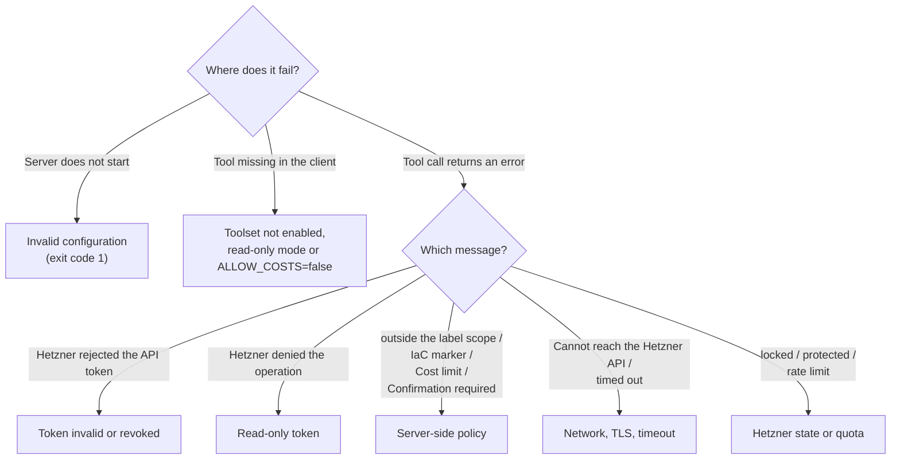

# Troubleshooting

Find your symptom, check the cause, apply the fix. Quoted messages are the texts from `src/config.ts`, `src/guards.ts` and `src/hetzner/errors.ts`. Text in `<...>` is a placeholder. Error results from Hetzner end with `[hetzner: <code>, HTTP <status>]`. Configuration details are in [configuration](configuration.md), the security background in [security](security.md).



## Quick reference

| Symptom (message) | Section |
|---|---|
| `Invalid configuration:` and the process exits | [Server does not start](#server-does-not-start) |
| `Hetzner rejected the API token (HTTP 401).` | [401](#401-hetzner-rejected-the-api-token) |
| `Hetzner denied the operation (HTTP 403)` | [403](#403-hetzner-denied-the-operation) |
| `Not found (HTTP 404)` | [404](#404-not-found) |
| `A resource with the same unique value already exists` | [409](#409-already-exists-or-changed) |
| `The resource is locked because another action is running on it.` | [423 locked](#423-locked) |
| `The resource is protected against this action.` | [423 protected](#423-protected) |
| `Hetzner rate limit reached` | [429](#429-rate-limit) |
| `The request to Hetzner timed out` | [Timeouts](#timeouts) |
| `Cannot reach the Hetzner API` | [Network and TLS](#network-and-tls-errors) |
| A tool does not show up | [A tool is missing](#a-tool-is-missing) |
| `Confirmation required.` | [Confirmation](#confirmation-required) |
| `... is outside the label scope` | [Label scope](#outside-the-label-scope) |
| `... carries the infrastructure-as-code marker` | [IaC marker](#infrastructure-as-code-marker) |
| `Cost limit exceeded` / `Cost limit check failed` | [Cost limit](#cost-limit) |
| `Hetzner action <id> (<command>) failed` | [Failed action](#a-hetzner-action-failed) |
| `Still running after <s> s; follow up with action_get.` | [Action still running](#an-action-is-still-running) |
| `Warning: ... lock ...` in a firewall preview | [Lock-out warning](#lock-out-warning) |

## Server does not start

**Symptom.** The client shows the server as failed or disconnected. Running it in a terminal prints, for example:

```text
Invalid configuration:
  - HETZNER_TOKEN: is required (API token of the Hetzner Cloud project; HCLOUD_TOKEN is accepted as an alias)
```

**Cause.** The server validates the environment at startup, lists every problem and exits with code 1. There is no default token. Other messages of the same kind:

| Message | Cause |
|---|---|
| `HETZNER_TOKEN: must not contain whitespace or control characters` (also for `HCLOUD_TOKEN`) | A line break or space was copied with the token. |
| `HETZNER_TOKEN and HCLOUD_TOKEN are both set to different values; set only one (each token belongs to exactly one project)` | Both variables are set with different values. |
| `HETZNER_API_URL: must be an https URL (http is only allowed for localhost)` | The URL is malformed or uses plain `http` for a non-local host. |
| `HETZNER_MCP_PROJECT_NAME: must start with a letter and contain only a-z, 0-9 and '-' (max 32)` | Invalid name. |
| `HETZNER_MCP_TOOLSETS: unknown toolset '<name>' (valid: core, info, actions, ssh_keys, firewalls, storage, all)` | Typo in the toolset list. |
| `HETZNER_MCP_LABEL_SCOPE: '<term>' must have the form key=value (only equality, values must not be empty)` | The scope uses `!=`, `in`, a bare key or an empty value. |
| `HETZNER_MCP_LABEL_SCOPE: key '<key>' appears twice` | A scope key is listed twice. |
| `HETZNER_MCP_LABEL_SCOPE: invalid label key '<key>'` / `invalid label value '<value>'` | Not valid as a Hetzner label. |
| `HETZNER_MCP_LABEL_SCOPE: the prefix 'hetzner.cloud/' is reserved by Hetzner` | Scope key starts with `hetzner.cloud/`. |
| `HETZNER_MCP_IAC_POLICY: must be one of: off, warn, block` | Typo in the policy. |
| `HETZNER_MCP_IAC_LABELS: must not be empty while HETZNER_MCP_IAC_POLICY is not 'off'` | An empty marker list needs the policy `off`. |
| `HETZNER_MCP_TIMEOUT_MS: must be an integer between 1000 and 300000 (milliseconds)` | Out of range or not an integer. |
| `HETZNER_MCP_ACTION_WAIT_MS: must be an integer between 0 and 600000 (milliseconds)` | Out of range or not an integer. |
| `HETZNER_MCP_FIREWALL_GUARD_PORTS: '<value>' must be a list of TCP ports between 1 and 65535 (comma-separated, at most 10)` | Invalid port list. |
| `HETZNER_MCP_MAX_MONTHLY_COST: must be a non-negative decimal number with '.' as separator (net amount per month in the pricing currency, e.g. 5.00)` | A comma as decimal separator, a sign or a unit. |
| `HETZNER_MCP_READ_ONLY: must be true or false` (also for `REQUIRE_CONFIRMATION`, `ALLOW_COSTS`) | Not a boolean. |
| `HETZNER_MCP_LOG_LEVEL: must be one of: debug, info, warn, error` | Invalid log level. |

**Fix.** Set the missing variables in the `env` block of your MCP client (see [clients](clients.md)). Most GUI clients do not inherit variables from your shell. Test in a terminal:

```bash
HETZNER_TOKEN=<api-token> npx -y hetzner-model-context-protocol
```

The server logs `hetzner-model-context-protocol started` to stderr and then waits for MCP messages on stdin. Startup does not contact Hetzner; the first request happens on the first tool call, so a wrong or revoked token shows up there, not at startup.

**Startup warnings** (logged, the server still runs):

| Warning | Meaning |
|---|---|
| `HETZNER_API_URL points to '<host>' instead of api.hetzner.cloud; the API token is sent to that host.` | You set a different API host. Intended for tests and proxies. |
| `HETZNER_MCP_REQUIRE_CONFIRMATION=false: destructive and cost-incurring tools run without confirmation and without a cost preview.` | Both confirmations are off. |
| `HETZNER_MCP_ACTION_WAIT_MS is above 55000 ms; MCP clients with a 60 s request timeout may drop waiting tool calls. Prefer wait=false plus action_get.` | See [Timeouts](#timeouts). |

## 401: Hetzner rejected the API token

**Message.**

```text
Hetzner rejected the API token (HTTP 401). Check HETZNER_TOKEN: it may be invalid or revoked, or its project may have been deleted [hetzner: unauthorized, HTTP 401]
```

**Cause.** Wrong, revoked or expired token, or the project was deleted. The token may also belong to a different project than you expect.

**Fix.** Create a new token in the Hetzner Cloud Console and update the client configuration. Restart the client, because the token is read at startup.

## 403: Hetzner denied the operation

**Message.**

```text
Hetzner denied the operation (HTTP 403): the API token lacks the permission. If it is a Read-only token, create a Read & Write token in the project (Security → API Tokens), or run with HETZNER_MCP_READ_ONLY=true [hetzner: forbidden, HTTP 403]
```

**Cause.** The token is Read-only and the tool tried to write. Read-only mode of the server (`HETZNER_MCP_READ_ONLY=true`) would have hidden such tools.

**Fix.** Use a Read & Write token if the change is intended. Otherwise set `HETZNER_MCP_READ_ONLY=true` so the assistant is not offered tools it cannot use.

Other 403 cases: `Hetzner cannot perform this operation right now because of maintenance. Try again later; do not retry in a loop` and `The project has reached a resource limit: <name>. Delete unused resources or ask Hetzner support to raise the limit`.

## 404: Not found

**Message.** `Not found (HTTP 404): the resource does not exist in this project. Check the ID with the matching *_list tool`

**Cause.** The ID does not exist in the project of the token, was deleted, or belongs to another project. A second `*_delete` call on the same resource also ends here.

**Fix.** List the resources (`server_list`, `volume_list`, ...) and use the ID from the result. Check that the token belongs to the project you mean.

## 409: Already exists or changed

| Message | Cause and fix |
|---|---|
| `A resource with the same unique value already exists: <fields>. Choose a different value or use the existing resource` | A name (server, SSH key, firewall, volume) is already in use in the project. |
| `The resource changed while the request was processed. Load it again and retry` | Another change happened at the same time. Read the resource again. |
| `The firewall is still applied to resources. Remove it from all resources first, then delete it` | Delete order: first `firewall_remove_from_resources`, then `firewall_delete`. |
| `The firewall is applied to this server through a label selector and cannot be removed from it directly. Remove the label selector target instead` | Remove the selector, not the server. |

## 423: Locked

**Message.** `The resource is locked because another action is running on it. Wait for that action (action_list / action_get) and retry`

**Cause.** Another action is still running on the resource (the server list shows `locked: true`).

**Fix.** Look at `action_list` for the resource, wait for the running action (`action_get`), then call again.

## 423: Protected

**Message.** `The resource is protected against this action. Protection is never removed automatically: ask the user whether to disable it with the matching *_protection_set tool, then retry`

**Cause.** Delete or rebuild protection is on. The confirmation preview already starts with `Hetzner will refuse this: ...` in that case.

**Fix.** Only if you really want it: disable protection with `server_protection_set`, `volume_protection_set` or `snapshot_protection_set` (destructive tools, they ask for confirmation), then repeat the operation. The server never removes protection by itself.

## 429: Rate limit

**Message.** `Hetzner rate limit reached (<limit> requests per hour for this project, <remaining> left). Wait at least <s> s before the next call and avoid polling; the full quota is back at <time>`

**Cause.** The project's request quota is used up. The server retries read requests and some other requests a limited number of times with short waits, but never repeats a create (`POST`) request, because that could order twice.

**Fix.** Wait as the message says. Avoid loops of `action_get`; use `wait: true` on the tool that started the action. Large lists cost one request per page; use filters.

## Timeouts

**Message.** `The request to Hetzner timed out after <ms> ms. Increase HETZNER_MCP_TIMEOUT_MS or try again; for write operations, first check whether the change was applied`

**Cause.** One request took longer than `HETZNER_MCP_TIMEOUT_MS` (default 30000).

**Fix.** Raise `HETZNER_MCP_TIMEOUT_MS` (up to 300000). For a write operation, check with the matching `*_get`, `*_list` or `action_list` tool whether it went through before you repeat it. The server does not retry a timed-out request.

**Client drops the call while waiting for an action.** Tools that start Hetzner actions wait up to `HETZNER_MCP_ACTION_WAIT_MS` (default 50000 ms). A client with a 60 second request timeout and no progress handling gives up after that. Lower the value or use `wait: false` and follow up with `action_get`. See [configuration](configuration.md#timeouts-and-waiting).

## Network and TLS errors

**Message.** `Cannot reach the Hetzner API at <url>. Check network connectivity, proxy and TLS settings.`

**Cause.** DNS, firewall, proxy or certificate problem between the machine that runs the server and the API host. Often a corporate proxy with its own CA, or no internet access in a container.

**Fix.** Test from the same machine: `curl -sS -H "Authorization: Bearer <api-token>" https://api.hetzner.cloud/v1/locations`. For a proxy with its own CA use `NODE_EXTRA_CA_CERTS=/path/to/ca.pem` in the client's `env` block. Never set `NODE_TLS_REJECT_UNAUTHORIZED=0`; it turns off certificate checks for the whole Node process, and the token would be sent over an unverified connection. If you set `HETZNER_API_URL`, check the URL.

## A tool is missing

**Symptom.** The client does not list a tool, or a call ends with a "not found" protocol error.

| Cause | Fix |
|---|---|
| The toolset is not enabled. The default is `core,info,actions,ssh_keys`; `firewalls` and `storage` are opt-in. | Set `HETZNER_MCP_TOOLSETS` (for example `all`). |
| `HETZNER_MCP_READ_ONLY=true` hides every tool that is not read-only. | Unset it, and use a Read & Write token. |
| `HETZNER_MCP_ALLOW_COSTS=false` hides `server_create`, `server_change_type`, `volume_create`, `volume_resize`, `snapshot_create` and `backup_enable`. | Unset it, or accept that these cannot be used. |
| The client has not refreshed its tool list. | Restart the client or the server connection. The list is fixed at startup. |

The [tools reference](tools-reference.md) lists the toolset of every tool.

## Confirmation required

**Message.**

```text
Confirmation required. This would: <preview> Nothing was changed. Ask the user for approval, then call this tool again with confirm: true.
```

This is not a failure. Destructive tools and tools that can incur costs return a preview first. Show it to the user. If they agree, the assistant repeats the same call with `confirm: true`. If the assistant does not ask but calls again by itself, tell it to ask first. Setting `HETZNER_MCP_REQUIRE_CONFIRMATION=false` removes the step and is discouraged ([configuration](configuration.md#confirmation)).

## Outside the label scope

**Message.** `Resource <type> <id> is outside the label scope (HETZNER_MCP_LABEL_SCOPE=<scope>). Only resources carrying these labels may be changed. Nothing was changed.`

**Cause.** `HETZNER_MCP_LABEL_SCOPE` is set and the resource lacks one of the scope labels (or has a different value). Calls that touch several resources (a firewall and its servers, a volume and its server) check all of them.

**Fix.** Add the label to the resource in the Hetzner Cloud Console, or change the scope in the configuration. Related messages:

- `Label '<key>' is reserved by HETZNER_MCP_LABEL_SCOPE and must be '<value>'. Remove it from the labels or use that value.` Remove the scope key from the labels you pass, or use the scope value.
- `In label-scope mode a label selector must contain every scope term (<scope>) as its own term, so it cannot reach resources outside the scope.` Add the scope terms to the selector, for example `env=staging,role=web`.

## Infrastructure-as-code marker

**Message (policy `block`).** `<Type> <id> carries the infrastructure-as-code marker '<key>=<value>'. Changes are blocked (HETZNER_MCP_IAC_POLICY=block); change it in the infrastructure code instead. Nothing was changed.`

**Warning (policy `warn`).** `Warning: <type> <id> carries the infrastructure-as-code marker '<key>=<value>'; the next terraform/tofu apply may revert or conflict with this change.` It appears in the confirmation preview and in the result field `warnings`. The change is made.

**Fix.** Change the resource in the infrastructure code. Or set `HETZNER_MCP_IAC_POLICY=warn` or `off`, or change `HETZNER_MCP_IAC_LABELS`, if the marker label does not mean what you think.

## Cost limit

| Message | Cause and fix |
|---|---|
| `Cost limit exceeded: this call adds an estimated <amount> <currency>/month net, above HETZNER_MCP_MAX_MONTHLY_COST=<limit>. Nothing was changed. Tell the user; only the operator can raise the limit.` | The call adds more monthly net cost than the limit. Choose a smaller type or size, or raise the limit in the configuration. Passing `confirm: true` does not help. |
| `Cost limit check failed: Hetzner pricing could not be loaded, so the monthly cost of this call is unknown while HETZNER_MCP_MAX_MONTHLY_COST=<limit> is set. Nothing was changed. Try again later.` | The price list could not be fetched. The check fails closed. Try again later. |
| `Cost limit check failed: Hetzner lists no price for a part of this call, so its monthly cost is unknown while HETZNER_MCP_MAX_MONTHLY_COST=<limit> is set. Nothing was changed. Check pricing_get for the requested type and location.` | No price for the requested type, location or surcharge. Check `pricing_get`. |

The limit applies to a single call. See [configuration](configuration.md#cost-controls).

## A Hetzner action failed

**Message.** `Hetzner action <id> (<command>) failed: <code>: <message>`

**Cause.** The request was accepted, but the asynchronous action ended with an error, for example because a server could not be placed or started.

**Fix.** Read the code and message, check the resource with the `*_get` tool and the history with `action_list`. Do not repeat blindly.

Related API errors: `Hetzner could not place the server. Try another location or server type`; `The requested resource is currently not available (for example not orderable in this location). Choose another type or location (see catalog_server_types)`; `The server must be powered off for this action. Shut it down with server_power, wait until it is off, and retry` (for `server_change_type`); `There is no volume space left in this location. Choose another location`.

## An action is still running

**Message in the summary.** `Still running after <s> s; follow up with action_get.`

**Cause.** The tool waited `HETZNER_MCP_ACTION_WAIT_MS` and the action had not finished, or `wait: false` was passed. This is not an error; the operation continues at Hetzner.

**Fix.** Ask for the state with `action_get` (the IDs are in the `actions` field of the result). Do not repeat the original call.

## Lock-out warning

A preview of `firewall_set_rules` can contain warnings that SSH (or another guarded port) may become unreachable. They are warnings, not errors; nothing is blocked. What they cover and what they cannot see: [security](security.md#limits-of-the-lock-out-warning). If SSH runs on another port, set `HETZNER_MCP_FIREWALL_GUARD_PORTS`. If you did lock yourself out, remove or change the firewall rules in the Hetzner Cloud Console.

## Other messages

| Message | Meaning |
|---|---|
| `Hetzner rejected the input: <field>: <message>; ...` | Hetzner's validation failed (at most 5 fields are listed). Correct the named field. |
| `This resource does not support the requested action` | The resource cannot do this, for example a feature that its type lacks. |
| `Hetzner reported an internal error. Try again later` (500) and the `bad gateway`/`did not answer in time` variants | Problem on Hetzner's side. For write operations, check with the matching `*_get`, `*_list` or `action_list` tool whether the change was applied before you try again. |
| `Hetzner has removed this API endpoint. Update hetzner-model-context-protocol to a newer version` | The API changed. Update the package. |
| `Unexpected response from Hetzner` / `An unexpected error occurred while talking to Hetzner.` | Unexpected case. Run with `HETZNER_MCP_LOG_LEVEL=debug` and open an issue without secrets. |
| `The request was cancelled by the client. For write operations, check whether the change was applied before retrying` | The client aborted the call. |

## Getting more detail

Set `HETZNER_MCP_LOG_LEVEL=debug`. The server then logs every request to Hetzner on stderr with method, path, status, attempt and duration, never the token, query or body. Where to find stderr depends on your client. If you report a problem, remove names and labels first and never include the token.
